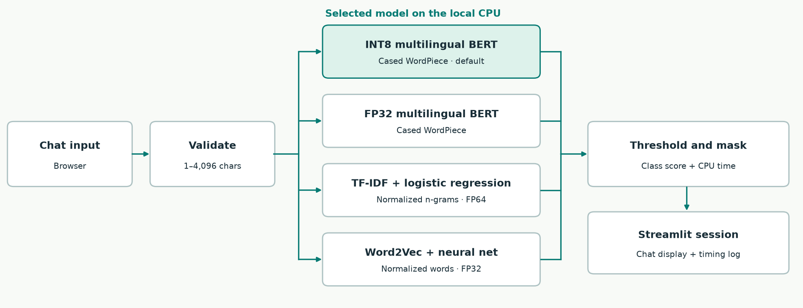

# Runtime architecture

1. The browser sends the typed message to the local Streamlit process. Validation accepts 1–4,096 characters after the empty-input check.
2. The active model is loaded once per cached resource. Classical paths use Unicode/regex normalization, word tokens and model-specific vectorization. BERT paths keep case and use up to 64 WordPiece tokens, including special tokens.
3. A model yields an offensive score. Each model's threshold was chosen on validation data. The INT8 model inherits the FP32 threshold. Confidence is the selected class score.
4. Clean messages appear as entered (outer whitespace stripped). Flagged text is replaced by a fixed mask. The side panel records each selected-model time. The comparison button runs all four on the last original input. A separate distance-based rule is shown below the table.
5. The last original input is held in session memory for comparison. The session log keeps the displayed form, decision, model, score and time. Clear session removes both forms of history. The app writes no message logs to disk.
