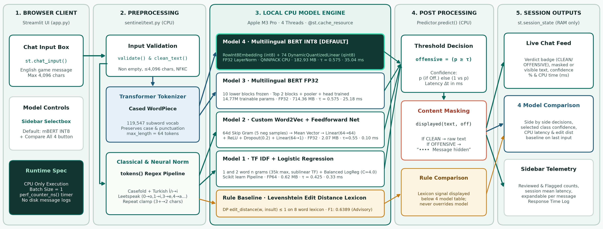

# SentinelAI
## Real-time moderation of English gaming chat
Ali Edip Mangtay · 210911044 · SWE015 Introduction to Large Language Models · Use Case 4

### Research question
Can a quantized multilingual BERT screen one English message on CPU within a mean budget of 50 milliseconds, while still detecting abusive language? This experiment compares four models on identical held-out messages and deploys the quantized model in an interactive chat.

### Principal finding
The INT8 model reached macro-F1 0.8262 on 500 test comments. Its mean inference time was 35.04 ms and its model directory occupied 182.93 MB. Full-precision BERT took 25.18 ms and occupied 714.36 MB. Quantization reduced storage by 74.4% on this system, with a 9.86 ms increase in average processing time.

### Data and labels
The pinned Jigsaw training file contains 159,571 English Wikipedia comments with six toxicity flags. Any positive flag maps to OFFENSIVE. Six zeros map to CLEAN. Grouping by normalized text, discarding conflicting groups (13) and removing duplicates left 159,295 eligible rows. Stratified sampling with seed 42 selected 5,000 comments for the local experiment.

| Split | Messages | Clean | Offensive | Used for |
|---|---:|---:|---:|---|
| Training | 4,000 | 3,594 | 406 | Fit features and model parameters |
| Validation | 500 | 449 | 51 | Select thresholds and checkpoints |
| Held-out test | 500 | 450 | 50 | Compare final predictions |

A classifier that marked every test message clean would score 90% accuracy and detect zero offensive comments. Macro-F1 gives equal weight to the clean and offensive class F1 scores. The project also reports offensive recall to show how many abusive comments a moderator would miss.

<!-- page -->
## System design and training
The browser sends a new message to Streamlit. The application validates it, loads the selected model from its local cache and runs inference on CPU. Entering text uses the active model. The comparison button runs the same last input through all four.

### The four model paths
**TF-IDF + logistic regression.** Unicode and regex processing normalize noisy spellings before word unigram and bigram extraction. The model uses sublinear term frequency, minimum document frequency two and balanced class weights. Validation selected C = 4 and threshold 0.425.

**Word2Vec + feedforward network.** Skip-gram learned 64-dimensional embeddings from training messages using a window of two and five negative samples. A 64-unit ReLU layer, 20% dropout and a weighted binary loss classify the mean word vector. Validation selected epoch 17 and threshold 0.55.

**Multilingual BERT FP32.** The original cased WordPiece tokenizer processes up to 64 tokens. The embeddings and lower ten blocks remain frozen. AdamW updated 14,767,874 parameters in the top two blocks, pooler and head using a learning rate of 0.00004 and batches of 16. Epoch three achieved validation macro-F1 0.878 at threshold 0.575.

**Multilingual BERT INT8.** The selected checkpoint supplied the weights for 74 dynamically quantized linear layers and row-wise signed INT8 word embeddings. Layer normalization and other operations use floating point. The quantized model inherits the FP32 threshold. It is the application's default.

An independent edit-distance lexicon allows one spelling edit. On its own it detected 10 of 50 offensive test comments, for macro-F1 0.639. It supplies a comparison signal. It does not override the learned model's decision.

<!-- page -->
## Benchmark and moderation errors
All four models scored the same 500 held-out IDs. Each model also processed the same 150 timed single-message inputs after 15 warm-ups. Hardware was an Apple M3 Pro (12 cores, 36 GB) with four PyTorch threads. The timer covers model preprocessing, inference and the decision. Loading and browser rendering fall outside it. Size is the complete runnable model directory in decimal MB.

| Model | Macro-F1 | Accuracy | Size (MB) | Mean (ms) | P95 (ms) |
|---|---:|---:|---:|---:|---:|
| TF-IDF + logistic regression | 0.7852 | 92.2% | 0.62 | 0.330 | 0.653 |
| Word2Vec + neural network | 0.7921 | 91.6% | 2.07 | 0.102 | 0.320 |
| Multilingual BERT FP32 | 0.8002 | 93.0% | 714.36 | 25.180 | 28.622 |
| Multilingual BERT INT8 | 0.8262 | 93.8% | 182.93 | 35.038 | 45.076 |

### Which errors would a moderator see?
| Model | Offensive precision | Offensive recall | Clean hidden | Offensive missed |
|---|---:|---:|---:|---:|
| TF-IDF + logistic regression | 60.8% | 62.0% | 20 | 19 |
| Word2Vec + neural network | 56.3% | 72.0% | 28 | 14 |
| Multilingual BERT FP32 | 66.0% | 62.0% | 16 | 19 |
| Multilingual BERT INT8 | 69.4% | 68.0% | 15 | 16 |

TF-IDF had the smallest footprint. Word2Vec was fastest and detected the most offensive comments, at the cost of hiding 28 clean messages. FP32 was the faster BERT. INT8 had the highest macro-F1, caught 34 of 50 offensive comments and hid 15 of 450 clean comments. Its 35.04 ms mean met the preset budget. Individual requests can take longer.

### A missed case
“Somebody out there hates you ... See here.” The Jigsaw label was OFFENSIVE. INT8 returned CLEAN with an offensive score of 0.0044, below its threshold of 0.575. The example illustrates the difficulty of detecting indirect hostility from a single message. The original test ID is `779c81facf11970b`.

<!-- page -->
## Reproduction and limits
### Running the submitted system
Clone the linked repository and extract the trained-model release into its root. Install the pinned requirements with Python 3.12 and run `streamlit run app.py`. On macOS, `zsh Baslat.command` also sets up the local environment. The release includes the fitted classical and neural models, tokenizers and both BERT variants.

The measured configuration used Python 3.12.15, PyTorch 2.14.1, Transformers 5.20.2 and QNNPACK on macOS arm64. The source includes the pinned data and pretrained model revisions, split IDs, prediction CSVs, training histories and individual benchmark timings. The test suite covers preprocessing, reload, inference, masking, changing models, comparison and session reset.

### Limitations and next experiment
The test set contains 50 offensive examples from Wikipedia discussions. A two-example disagreement changes offensive recall by four percentage points. The observed INT8 advantage in macro-F1 could change on another sample. The confidence shown in the chat is a model score, not a calibrated probability of harm.

Short game chat has different vocabulary, spelling and conversational context. A next experiment would label real gaming messages, distinguish direct and indirect abuse, and compare recall at several moderation thresholds. Deployment testing should measure end-to-end response times with concurrent users and cold model loads.

### Evidence and attribution
[Source code and reproduction instructions](https://github.com/EdipMangtay/SWE_Project_final) · [Two-minute narrated demo video](https://www.youtube.com/watch?v=y2xdjGgESAE) · [Held-out predictions and timing records](https://github.com/EdipMangtay/SWE_Project_final/tree/main/runs/final/results)

[Jigsaw Toxic Comment Classification Challenge](https://www.kaggle.com/competitions/jigsaw-toxic-comment-classification-challenge) · [Dataset mirror used in this run](https://huggingface.co/datasets/Heliosoph/Jigsaw-Toxic-Comments)

[Google multilingual BERT checkpoint](https://huggingface.co/google-bert/bert-base-multilingual-cased) · [Skip-gram and negative sampling](https://arxiv.org/abs/1310.4546) · [PyTorch dynamic quantization](https://docs.pytorch.org/docs/stable/generated/torch.ao.quantization.quantize_dynamic.html)

OpenAI ChatGPT / Codex assisted with implementation, debugging, experiment tooling and drafting the report, slides and narration. The numerical results come from the executed project. Training code, recorded outputs and the presentation are available for inspection.
